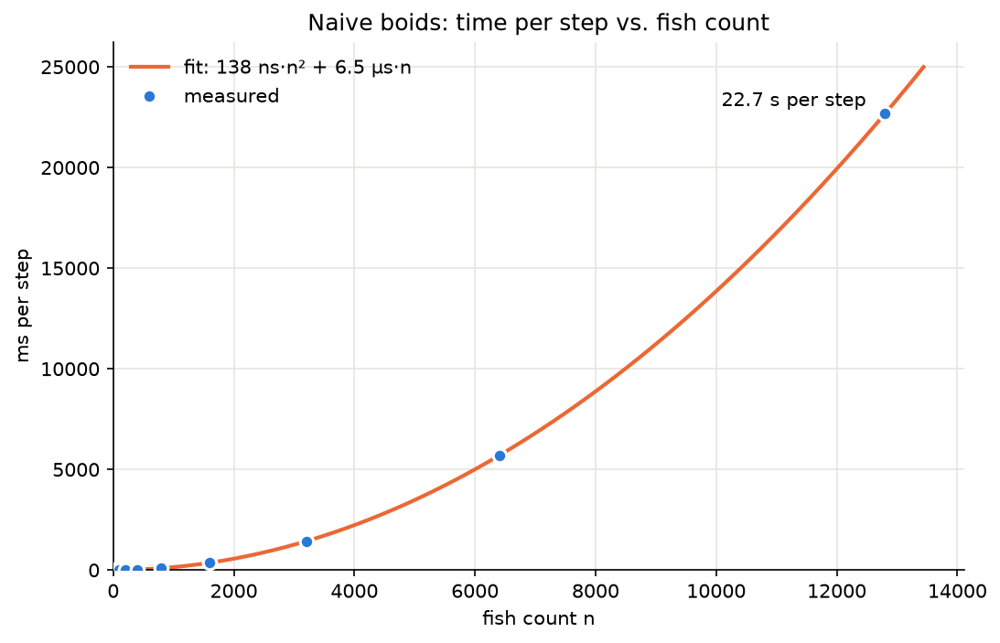
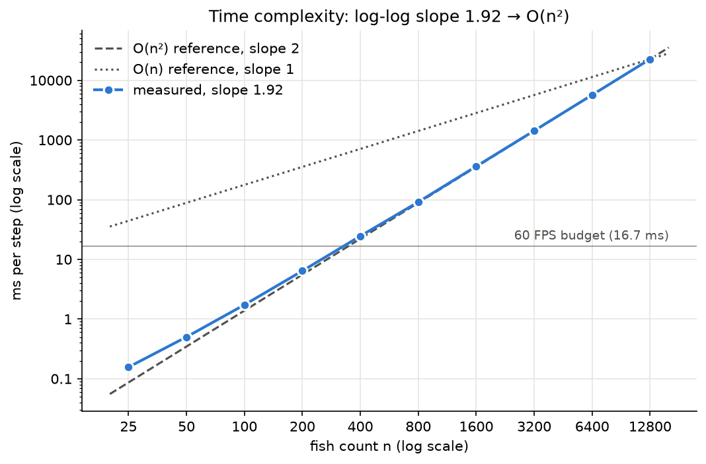

# Boids in Python + PyGame: a step-by-step proof of concept

This tutorial walks you through building a **2D naive O(n²) boids simulation** in Python
with PyGame. It is the proof of concept for Phase 2 of the main C++ project. When you
are done you will have:

- a window full of fish (triangles) that school together,
- live sliders for the **separation**, **alignment** and **cohesion** weights,
- the **frame rate** (and the time per simulation step) shown at the top,
- a small benchmark script that shows the O(n²) cost with real numbers.

There is no OpenMP, CUDA or spatial grid here. Every fish checks every other fish. That
is the point: you will *feel* why the later phases exist.

> **How to use this tutorial:** type the code yourself instead of copy-pasting. Each step
> ends with a **Checkpoint** describing what you should see. Don't move on until it works.

---

## The result

This is the finished POC running with `python main.py` and the default slider weights
(Separation 1.50, Alignment 1.00, Cohesion 1.00):


The window opens on a terminal running `python main.py`. Within seconds the fish, which start
at random positions and headings, group into schools whose members point the same way. The
schools drift across the screen, wrap around the edges, and merge into larger groups or
break apart when they meet. The HUD in the top-left shows the frame rate holding at about
60 FPS (16 ms per frame), and the three sliders in the top-right sit at their defaults. The
rest of this tutorial builds this, one step at a time.

---

## Table of contents

0. [What we are building](#step-0--what-we-are-building)
1. [Project setup: folder, venv, PyGame](#step-1--project-setup-folder-venv-pygame)
2. [The game loop: an empty window](#step-2--the-game-loop-an-empty-window)
3. [Showing the frame rate](#step-3--showing-the-frame-rate)
4. [A quick tour of `Vector2`](#step-4--a-quick-tour-of-vector2)
5. [Settings in one place](#step-5--settings-in-one-place)
6. [The `Fish` class: state and drawing](#step-6--the-fish-class-state-and-drawing)
7. [Movement: velocity, speed limits, wrapping](#step-7--movement-velocity-speed-limits-wrapping)
8. [A fixed simulation timestep](#step-8--a-fixed-simulation-timestep)
9. [Steering: the core idea of boids](#step-9--steering-the-core-idea-of-boids)
10. [The three rules, one at a time](#step-10--the-three-rules-one-at-a-time)
11. [The `Flock` class: naive O(n²) update](#step-11--the-flock-class-naive-on²-update)
12. [Fusing the three loops into one](#step-12--fusing-the-three-loops-into-one)
13. [Sliders for the weights](#step-13--sliders-for-the-weights)
14. [Keyboard controls: pause and reset](#step-14--keyboard-controls-pause-and-reset)
15. [Measuring the O(n²) cost](#step-15--measuring-the-on²-cost)
16. [Tuning guide and troubleshooting](#step-16--tuning-guide-and-troubleshooting)
17. [Exercises and the bridge to C++](#step-17--exercises-and-the-bridge-to-c)

---

## Step 0: What we are building

### Boids in one paragraph

In 1986 Craig Reynolds showed that realistic flocking needs no leader and no global plan.
Each agent (a "boid") looks only at the neighbors within a small radius and follows three
local rules:

| Rule           | Plain English                                  | Effect when its weight is high      |
|----------------|------------------------------------------------|-------------------------------------|
| **Separation** | "Don't crowd your neighbors."                  | Fish spread out like a gas          |
| **Alignment**  | "Swim in the same direction as your neighbors." | Fish form parallel streams          |
| **Cohesion**   | "Move toward the center of your neighbors."     | Fish clump into tight balls         |

Add a little random **wander** so it doesn't look mechanical, and schooling *emerges*.

### Final file layout

```
pypg-poc/
├── tutorial.md        ← this file
├── POC.gif            ← screen recording of the finished POC (see "The result")
├── requirements.txt   ← pinned Python dependencies (pygame-ce, matplotlib)
├── .gitignore         ← ignores .venv/ and __pycache__/
├── settings.py        ← every constant in one place
├── fish.py            ← Fish class: state, steering helper, movement, drawing
├── flock.py           ← Flock class: the naive O(n²) simulation step
├── slider.py          ← a minimal UI slider (PyGame has none built in)
├── main.py            ← window, game loop, HUD, input
├── bench.py           ← headless benchmark (no window), writes CSV + graphs
└── benchmark/         ← bench.py output: bench_results.csv, ms_vs_n.png, complexity_loglog.png
```

The split mirrors the C++ architecture: **simulation** (`fish.py`, `flock.py`) is separate
from the **app/render** side (`main.py`, `slider.py`). `flock.py` never touches the
window; it just updates numbers.

---

## Step 1: Project setup: folder, venv, PyGame

### 1.1 Why a virtual environment?

A **venv** is a private copy of the Python package directory for one project. Packages you
install there don't touch the system Python (Ubuntu actually refuses system-wide `pip
install` nowadays) and don't clash with other projects.

### 1.2 Create and activate it

From the repository root:

```bash
cd pypg-poc
python3 -m venv .venv          # creates the folder .venv/ with its own python + pip
source .venv/bin/activate      # Linux/macOS (Windows: .venv\Scripts\activate)
```

Your prompt now starts with `(.venv)`. Check that you are using the venv's Python:

```bash
which python      # → .../School-of-Fish/pypg-poc/.venv/bin/python
python --version
```

Run `deactivate` to leave the venv. You need to `source .venv/bin/activate` again in
every new terminal.

### 1.3 Install PyGame

```bash
python -m pip install --upgrade pip
python -m pip install pygame
```

> **If the install fails while compiling** (`error: subprocess-exited-with-error`, missing
> SDL headers…): there is probably no prebuilt wheel of `pygame` for your Python version yet
> (this machine runs Python 3.14, which is very new). Use the community edition instead.
> It is a drop-in replacement that is still imported as `import pygame`:
>
> ```bash
> python -m pip install pygame-ce
> ```
>
> Install **one or the other**, never both.
>
> On the development machine (Ubuntu 26.04, Python 3.14), `pygame-ce==2.5.8` is what
> ended up in `requirements.txt`.

Verify:

```bash
python -c "import pygame; print(pygame.version.ver)"
```

### 1.4 Record the dependency and ignore generated files

```bash
python -m pip freeze > requirements.txt   # e.g. "pygame==2.6.1"
```

Anyone (including future you) can now recreate the environment with
`python -m pip install -r requirements.txt`.

Create `pypg-poc/.gitignore`:

```gitignore
.venv/
__pycache__/
```

**Checkpoint:** the `import pygame` command prints a version number.

---

## Step 2: The game loop: an empty window

Every real-time program (games, simulations, the C++ app later) has the same skeleton:

```
initialize
while running:
    1. handle input events
    2. update the world
    3. draw the world
    4. show the frame
shut down
```

Create `main.py` with just the skeleton:

```python
import pygame

WIDTH, HEIGHT = 1200, 800


def main():
    pygame.init()                                        # start all PyGame subsystems
    screen = pygame.display.set_mode((WIDTH, HEIGHT))    # the window's drawing surface
    pygame.display.set_caption("School of Fish - PyGame POC")
    clock = pygame.time.Clock()                          # for frame timing (next step)

    running = True
    while running:
        # 1. Input: the OS queues events (key presses, mouse, window close).
        #    You MUST drain this queue every frame, or the OS thinks the app froze.
        for event in pygame.event.get():
            if event.type == pygame.QUIT:                # clicked the window's X
                running = False

        # 2. Update: nothing yet.

        # 3. Draw: clear the whole frame first, then draw everything on top.
        screen.fill((10, 30, 50))                        # dark ocean blue (R, G, B)

        # 4. Present: PyGame draws into a hidden back buffer; flip() swaps it to the screen.
        pygame.display.flip()

        clock.tick(60)                                   # wait so we run at most 60 FPS

    pygame.quit()


if __name__ == "__main__":
    main()
```

Run it:

```bash
python main.py
```

### What to understand

- **Double buffering:** you draw into an invisible buffer and `flip()` shows it all at
  once. Without this you would see half-drawn frames (flicker).
- **Clear every frame:** `screen.fill(...)` erases last frame's fish. Comment it out
  later and watch the fish leave trails. It's a fun way to see what it does.
- **The `if __name__ == "__main__":` guard** runs `main()` only when the file is executed
  directly, not when it is imported (`bench.py` will import modules without opening a
  window).

**Checkpoint:** a dark blue 1200×800 window that closes when you click X.

---

## Step 3: Showing the frame rate

`clock.tick(60)` does two things: it sleeps so the loop doesn't exceed 60 FPS, and it
**returns how many milliseconds passed since the previous call**. `clock.get_fps()`
gives the average FPS over the last few frames.

Changes to `main.py`:

```python
# before the loop:
font = pygame.font.Font(None, 24)    # None = PyGame's built-in default font, size 24

# inside the loop, replace clock.tick(60) at the bottom with this at the TOP of the loop:
frame_ms = clock.tick(60)            # time the previous frame took, in milliseconds

# in the draw section, after screen.fill(...):
hud = f"FPS: {clock.get_fps():5.1f}   frame: {frame_ms:4.1f} ms"
text_surface = font.render(hud, True, (230, 230, 230))   # True = antialiased
screen.blit(text_surface, (10, 10))                      # copy text onto the screen at (10, 10)
```

### What to understand

- `font.render()` turns text into an image (a `Surface`). `blit()` copies one surface onto
  another. Everything you draw in PyGame is surfaces being blitted.
- **FPS vs. frame time:** 60 FPS = 16.7 ms per frame. Frame time is the more useful
  number for performance work because it adds up linearly (simulation 10 ms + drawing
  5 ms = 15 ms), while FPS doesn't.
- The window's top-left is `(0, 0)` and **y grows downward**. Remember this when you
  think about angles.

**Checkpoint:** "FPS: 60.0" (roughly) in the top-left corner.

---

## Step 4: A quick tour of `Vector2`

Boids is all vector math. PyGame ships a 2D vector class, `pygame.math.Vector2`, so you
don't need NumPy. Try it in a Python shell (`python` inside the venv):

```python
>>> from pygame.math import Vector2
>>> a = Vector2(3, 4)
>>> a.length()            # √(3² + 4²)
5.0
>>> a.length_squared()    # 3² + 4², no square root, cheaper
25.0
>>> a.normalize()         # same direction, length 1
Vector2(0.6, 0.8)
>>> a * 2, a + Vector2(1, 1), a - Vector2(1, 1)
(Vector2(6, 8), Vector2(4, 5), Vector2(2, 3))
>>> b = Vector2(a)        # a COPY. Plain `b = a` would make both names point to one object!
>>> a.scale_to_length(10) # change the length in place, keep the direction
>>> a
Vector2(6, 8)
>>> Vector2(0, 0).normalize()
ValueError: Can't normalize Vector of length Zero
```

### What to understand

- **Use `length_squared()` for comparisons.** "Is the distance < 60?" is the same
  question as "is the distance² < 3600?", and it skips a square root. In an O(n²) loop
  that matters.
- **`normalize()` and `scale_to_length()` crash on zero vectors.** Every time we call
  them we will guard against length 0 first.
- **`+=` modifies in place**, `a = a + b` creates a new vector. Both are fine here, but
  remember that `Vector2` is a mutable object, so be careful about sharing one between
  two fish.

---

## Step 5: Settings in one place

Magic numbers scattered across files are hard to tune. Create `settings.py`:

```python
# ---------------- Window ----------------
WIDTH, HEIGHT = 1200, 800
FPS_CAP = 60
BG_COLOR = (10, 30, 50)

# ---------------- Simulation ----------------
SIM_DT = 1.0 / 60.0          # fixed timestep in seconds (Step 8)
MAX_STEPS_PER_FRAME = 5      # protects against the "spiral of death" (Step 8)
NUM_FISH = 150
SEED = 42                    # same seed → same starting positions every run

# Units: pixels and seconds. Speeds are px/s, forces (accelerations) are px/s².
MIN_SPEED = 40.0
MAX_SPEED = 120.0
MAX_FORCE = 200.0            # max steering acceleration per rule

PERCEPTION_RADIUS = 60.0     # neighbors within this distance count for align/cohesion
SEPARATION_RADIUS = 25.0     # neighbors closer than this push the fish away

# Default weights (the sliders start here)
SEPARATION_WEIGHT = 1.5
ALIGNMENT_WEIGHT = 1.0
COHESION_WEIGHT = 1.0
WANDER_STRENGTH = 20.0       # size of the random nudge, px/s²

# ---------------- Drawing ----------------
FISH_SIZE = 8                # nose-to-center length in pixels
```

Then in `main.py`, replace your local `WIDTH, HEIGHT`, the `60` and the background color
with `settings.WIDTH`, `settings.FPS_CAP`, `settings.BG_COLOR` (after `import settings`).

### What to understand

- **Choose units and stick to them.** Using px/s instead of "px per frame" means the
  motion speed doesn't change if the frame rate changes. This is the same reason the C++
  version uses a fixed timestep in seconds.
- `SEPARATION_RADIUS < PERCEPTION_RADIUS`: fish *notice* neighbors at 60 px but only
  *push away* at 25 px.

---

## Step 6: The `Fish` class: state and drawing

A fish's whole state is **position** and **velocity** (plus acceleration as a per-step
scratch value).

Create `fish.py`:

```python
import math

import pygame
from pygame.math import Vector2

import settings


class Fish:
    def __init__(self, pos, vel):
        self.pos = Vector2(pos)      # Vector2(...) makes a copy, so callers can't alias it
        self.vel = Vector2(vel)
        self.acc = Vector2(0, 0)     # sum of steering forces for the current step

    @classmethod
    def random(cls, rng):
        """A fish at a random position, swimming in a random direction."""
        pos = (rng.uniform(0, settings.WIDTH), rng.uniform(0, settings.HEIGHT))
        angle = rng.uniform(0, 2 * math.pi)
        speed = rng.uniform(settings.MIN_SPEED, settings.MAX_SPEED)
        vel = (math.cos(angle) * speed, math.sin(angle) * speed)
        return cls(pos, vel)
```

`rng` is a `random.Random(seed)` object we create once and pass in. Using your own seeded
generator (instead of the global `random.uniform`) makes runs **reproducible**: same seed,
same fish, same behavior. You need this to compare benchmark runs fairly.

### Drawing a triangle that points along the velocity

You need three corner points: a **nose** in front, two **tail** corners behind. Build them
from two perpendicular unit vectors:

- `d`: the direction of travel (`vel` normalized)
- `side`: `d` rotated by 90°, which is simply `(-d.y, d.x)`

```
            side ↑
                 |   tail-left
                 |  /
      ───────────●───────→ d          nose = pos + d·s
                 |  \
                 |   tail-right       tails = pos − 0.6·d·s ± 0.4·side·s
```

Add to the `Fish` class:

```python
    def draw(self, surface):
        # Direction of travel; fall back to "right" if the fish is somehow stopped.
        d = self.vel.normalize() if self.vel.length_squared() > 0 else Vector2(1, 0)
        side = Vector2(-d.y, d.x)                 # d rotated 90°
        s = settings.FISH_SIZE

        nose = self.pos + d * s
        tail_left = self.pos - d * (0.6 * s) + side * (0.4 * s)
        tail_right = self.pos - d * (0.6 * s) - side * (0.4 * s)

        pygame.draw.polygon(surface, (240, 200, 80), [nose, tail_left, tail_right])
```

This is **exactly** the math the C++ vertex shader will do (`rotated = x·d + y·side`). You
never compute an angle; the direction vector *is* the rotation.

### Test it before any physics

In `main.py`, before the loop:

```python
import random
from fish import Fish

rng = random.Random(settings.SEED)
fishes = [Fish.random(rng) for _ in range(settings.NUM_FISH)]
```

And in the draw section, after `screen.fill(...)` (and before the HUD, so text is on top):

```python
for f in fishes:
    f.draw(screen)
```

**Checkpoint:** 150 static yellow triangles pointing in random directions. Run it twice:
the layout must be identical (fixed seed).

---

## Step 7: Movement: velocity, speed limits, wrapping

Each step, a fish does basic physics (this is called **explicit Euler integration**):

```
velocity += acceleration · dt
position += velocity · dt
```

Then two fish-specific tweaks:

- **Clamp the speed** between `MIN_SPEED` and `MAX_SPEED`. Real fish don't stop dead or
  accelerate forever, and without a minimum, boids tend to stall in clumps.
- **Wrap around** the screen edges (a torus world): leave on the right, re-enter on the left.

Add to the `Fish` class:

```python
    def update(self, dt):
        self.vel += self.acc * dt

        speed = self.vel.length()
        if speed > settings.MAX_SPEED:
            self.vel.scale_to_length(settings.MAX_SPEED)
        elif 0 < speed < settings.MIN_SPEED:          # guard: can't scale a zero vector
            self.vel.scale_to_length(settings.MIN_SPEED)

        self.pos += self.vel * dt

        # Python's % always returns a value in [0, WIDTH), even for negative numbers
        # (-5 % 1200 == 1195), so this single line wraps both edges.
        self.pos.x %= settings.WIDTH
        self.pos.y %= settings.HEIGHT

        self.acc.update(0, 0)                         # forces are re-summed every step
```

Temporarily, in the update section of `main.py`:

```python
for f in fishes:
    f.update(1 / 60)
```

**Checkpoint:** fish swim in straight lines and reappear on the opposite side when they
leave the screen.

### What to understand

- **Order matters:** velocity first, then position (called "semi-implicit Euler"). It is
  more stable than updating position with the old velocity.
- **Resetting `acc`:** acceleration is not state that carries over. It is recomputed from
  the neighbors every step.

---

## Step 8: A fixed simulation timestep

Right now the simulation advances `1/60` s **per frame**. If the frame rate drops to 30
FPS (and it will, once O(n²) kicks in), the fish move at half speed. If you instead passed
the real frame time as `dt`, the simulation would behave differently on fast and slow
machines, and a big `dt` makes the physics unstable.

The standard fix is a **fixed timestep with an accumulator**: real time is poured into a
bucket, and the simulation takes as many fixed-size steps as the bucket allows.

```
frame time:   |--16ms--|------33ms------|--16ms--|
sim steps:    |  1 step | 2 steps        | 1 step  |   (each step is exactly 16.7 ms)
```

Replace the temporary update code in `main.py`:

```python
# before the loop:
accumulator = 0.0

# top of the loop (you already have frame_ms from Step 3):
frame_dt = min(frame_ms / 1000.0, 0.25)   # seconds; cap huge gaps (e.g. window dragged)

# update section:
accumulator += frame_dt
steps = 0
while accumulator >= settings.SIM_DT and steps < settings.MAX_STEPS_PER_FRAME:
    for f in fishes:
        f.update(settings.SIM_DT)
    accumulator -= settings.SIM_DT
    steps += 1
if steps == settings.MAX_STEPS_PER_FRAME:
    accumulator = 0.0                     # we can't keep up; drop the backlog
```

### What to understand

- **Simulation time is decoupled from frame rate**: the simulation always moves in exact
  `SIM_DT` steps, so it is deterministic and frame-rate independent. This is the C++
  architecture rule #4.
- **The spiral of death:** if one simulation step takes *longer* than `SIM_DT` (very
  possible with 1000 fish in Python!), every frame needs more steps than the last, which
  makes the frame even longer… forever. `MAX_STEPS_PER_FRAME` breaks the cycle: the
  simulation then simply runs slower than real time instead of freezing.

**Checkpoint:** same as Step 7, but the speed stays constant even if you change
`FPS_CAP` to 20.

---

## Step 9: Steering: the core idea of boids

Each rule produces a **desired direction**. Reynolds' trick is how to turn that into a
force:

```
desired = (desired direction, normalized) · MAX_SPEED   # "where I'd like to be going, at full speed"
steer   = desired − current velocity                    # the change needed to get there
steer   = clamp length to MAX_FORCE                      # turn gradually, not instantly
```

```
      current vel →→→→→
                        ↘  steer (the correction)
      desired     →→→→→→→↗  (points where the rule wants to go)
```

Because the force is the *difference* between desired and current velocity, a fish already
going the right way gets almost no force, and a fish going the wrong way gets a strong one.
`MAX_FORCE` makes turns smooth.

Add one helper to `Fish`. All three rules will use it:

```python
    def steer_towards(self, direction):
        """Steering force that turns this fish toward `direction` (any length)."""
        if direction.length_squared() == 0:
            return Vector2(0, 0)
        desired = direction.normalize() * settings.MAX_SPEED
        steer = desired - self.vel
        if steer.length_squared() > settings.MAX_FORCE ** 2:
            steer.scale_to_length(settings.MAX_FORCE)
        return steer
```

---

## Step 10: The three rules, one at a time

First write each rule as its **own function with its own loop over all fish**. It is
slow (three O(n²) passes) but very readable. We'll optimize in Step 12.

Each function takes the fish `f` and the full list `fishes`, and returns a steering force.
Put them in a new file `flock.py`:

```python
import random

from pygame.math import Vector2

import settings
from fish import Fish

PERCEPTION_SQ = settings.PERCEPTION_RADIUS ** 2
SEPARATION_SQ = settings.SEPARATION_RADIUS ** 2
```

### 10.1 Alignment: "go the way your neighbors go"

Average the neighbors' velocities and steer toward that direction.

```python
def alignment(f, fishes):
    total = Vector2(0, 0)
    count = 0
    for other in fishes:
        if other is f:                                    # don't count yourself
            continue
        if (other.pos - f.pos).length_squared() < PERCEPTION_SQ:
            total += other.vel
            count += 1
    if count == 0:
        return Vector2(0, 0)
    return f.steer_towards(total / count)
```

### 10.2 Cohesion: "go to the middle of your neighbors"

Average the neighbors' **positions** (their center of mass), then steer toward the vector
from you to that center.

```python
def cohesion(f, fishes):
    center = Vector2(0, 0)
    count = 0
    for other in fishes:
        if other is f:
            continue
        if (other.pos - f.pos).length_squared() < PERCEPTION_SQ:
            center += other.pos
            count += 1
    if count == 0:
        return Vector2(0, 0)
    center /= count
    return f.steer_towards(center - f.pos)                # vector from me to the center
```

### 10.3 Separation: "don't crowd"

For each neighbor that is *too* close, add a vector pointing **away** from it. Closer
neighbors should push harder, so weight by 1/distance:

```
away = (my pos − their pos)              length = d
away / d²  = (unit vector away) · (1/d)  → the closer, the stronger
```

Dividing by `d²` (which we already have as `length_squared()`) gives "unit direction × 1/d"
without any square root.

```python
def separation(f, fishes):
    push = Vector2(0, 0)
    for other in fishes:
        if other is f:
            continue
        offset = f.pos - other.pos                        # points AWAY from the neighbor
        d2 = offset.length_squared()
        if 0 < d2 < SEPARATION_SQ:                         # 0 < : skip exact overlaps (÷0)
            push += offset / d2
    return f.steer_towards(push)
```

### 10.4 Wander

A tiny random nudge each step so the school looks alive:

```python
def wander(rng):
    return Vector2(rng.uniform(-1, 1), rng.uniform(-1, 1)) * settings.WANDER_STRENGTH
```

### What to understand

- **Alignment uses neighbor *velocities*, cohesion uses neighbor *positions*.** That's the
  only real difference between the two functions.
- **Every rule only reads *other* fish.** That is what makes boids an **n-body** problem:
  each of n fish looks at n−1 others, so n·(n−1) ≈ **n²** distance checks per rule.

---

## Step 11: The `Flock` class: naive O(n²) update

The `Flock` owns the fish, the weights, and the random generator. Its `step(dt)` is the
whole simulation. Add to `flock.py`:

```python
class Flock:
    def __init__(self, n, seed):
        self.rng = random.Random(seed)
        self.fishes = [Fish.random(self.rng) for _ in range(n)]

        # Live-tunable weights (the sliders will write into these).
        self.separation_weight = settings.SEPARATION_WEIGHT
        self.alignment_weight = settings.ALIGNMENT_WEIGHT
        self.cohesion_weight = settings.COHESION_WEIGHT

    def step(self, dt):
        # Pass 1: compute every fish's acceleration from the CURRENT state.
        for f in self.fishes:
            f.acc = (separation(f, self.fishes) * self.separation_weight
                     + alignment(f, self.fishes) * self.alignment_weight
                     + cohesion(f, self.fishes) * self.cohesion_weight
                     + wander(self.rng))

        # Pass 2: only now move everybody.
        for f in self.fishes:
            f.update(dt)

    def draw(self, surface):
        for f in self.fishes:
            f.draw(surface)
```

### Why two passes? (important!)

If you moved each fish right after computing its force, fish #2 would react to where fish
#1 is *after* moving, while fish #1 reacted to where #2 was *before*. The result would
depend on list order, which is a bug that looks like "the flock drifts toward one side". With
two passes, every fish sees the **same snapshot** of the world. This is called a
**synchronous update**. It also matters for the C++ versions: in OpenMP and CUDA, all fish
are computed *at the same time*, so a snapshot is the only correct option.

### Wire it into `main.py`

Replace the `rng`/`fishes` list from Step 6 with:

```python
from flock import Flock

flock = Flock(settings.NUM_FISH, settings.SEED)
```

In the fixed-timestep loop, replace the `for f in fishes: f.update(...)` with:

```python
flock.step(settings.SIM_DT)
```

And in the draw section, use `flock.draw(screen)`.

**Checkpoint:** 🎉 fish form schools! Small groups merge, swim together, split up. If
everything collapses into one dot, or nothing happens, see Step 16.

---

## Step 12: Fusing the three loops into one

Your first optimization, before any parallelism: **do less work**. The three rule
functions each loop over all fish and each compute the same distances. One loop can
gather everything:

Replace the separate rule calls in `Flock.step` with a single fused loop:

```python
    def step(self, dt):
        fishes = self.fishes

        for f in fishes:
            push = Vector2(0, 0)          # separation accumulator
            vel_sum = Vector2(0, 0)       # alignment accumulator
            pos_sum = Vector2(0, 0)       # cohesion accumulator
            count = 0

            for other in fishes:
                if other is f:
                    continue
                offset = f.pos - other.pos
                d2 = offset.length_squared()
                if d2 >= PERCEPTION_SQ:
                    continue              # not a neighbor: skip everything
                count += 1
                vel_sum += other.vel
                pos_sum += other.pos
                if 0 < d2 < SEPARATION_SQ:
                    push += offset / d2

            acc = Vector2(0, 0)
            if count > 0:
                acc += f.steer_towards(vel_sum / count) * self.alignment_weight
                acc += f.steer_towards(pos_sum / count - f.pos) * self.cohesion_weight
            acc += f.steer_towards(push) * self.separation_weight
            acc += wander(self.rng)
            f.acc = acc

        for f in fishes:
            f.update(dt)
```

You can now delete (or keep for reference) the standalone `separation`, `alignment` and
`cohesion` functions.

### What to understand

- The complexity is **still O(n²)**, but the constant factor dropped by ~3× (one distance
  per pair instead of three). Big-O tells you how cost *scales*; constant factors decide
  real speed. You need both.
- The behavior should look identical. Use the fixed seed to compare before/after.
- In the C++ version this fused loop is the inner kernel you will port to the CPU,
  OpenMP and CUDA backends.

---

## Step 13: Sliders for the weights

PyGame has no UI widgets, so we write a minimal slider. It needs three things:

1. **State:** min, max, current value, and whether it is being dragged.
2. **Input handling:** mouse down on the track starts a drag, mouse motion updates the
   value, mouse up ends the drag.
3. **Drawing:** a track, a knob, a label with the value.

The value comes from the mouse x position mapped linearly onto `[min, max]`:

```
t     = (mouse_x − track_left) / track_width      clamped to [0, 1]
value = min + t · (max − min)
```

Create `slider.py`:

```python
import pygame


class Slider:
    def __init__(self, label, x, y, width, min_val, max_val, value):
        self.label = label
        self.rect = pygame.Rect(x, y, width, 6)       # the track
        self.min_val = min_val
        self.max_val = max_val
        self.value = value
        self.dragging = False

    def handle_event(self, event):
        if event.type == pygame.MOUSEBUTTONDOWN and event.button == 1:
            # inflate() makes the clickable area taller than the 6 px track.
            if self.rect.inflate(0, 20).collidepoint(event.pos):
                self.dragging = True
                self._set_from_mouse_x(event.pos[0])
        elif event.type == pygame.MOUSEBUTTONUP and event.button == 1:
            self.dragging = False
        elif event.type == pygame.MOUSEMOTION and self.dragging:
            self._set_from_mouse_x(event.pos[0])

    def _set_from_mouse_x(self, mouse_x):
        t = (mouse_x - self.rect.x) / self.rect.width
        t = max(0.0, min(1.0, t))
        self.value = self.min_val + t * (self.max_val - self.min_val)

    def draw(self, surface, font):
        pygame.draw.rect(surface, (90, 90, 110), self.rect, border_radius=3)
        t = (self.value - self.min_val) / (self.max_val - self.min_val)
        knob_x = self.rect.x + t * self.rect.width
        pygame.draw.circle(surface, (230, 230, 230), (int(knob_x), self.rect.centery), 8)
        text = font.render(f"{self.label}: {self.value:.2f}", True, (230, 230, 230))
        surface.blit(text, (self.rect.x, self.rect.y - 22))
```

### Wire the sliders into `main.py`

Create them before the loop (stacked in the top-right corner):

```python
x = settings.WIDTH - 240
sep_slider = Slider("Separation", x, 40, 200, 0.0, 5.0, settings.SEPARATION_WEIGHT)
ali_slider = Slider("Alignment", x, 90, 200, 0.0, 5.0, settings.ALIGNMENT_WEIGHT)
coh_slider = Slider("Cohesion", x, 140, 200, 0.0, 5.0, settings.COHESION_WEIGHT)
sliders = [sep_slider, ali_slider, coh_slider]
```

Inside the event loop, give every event to every slider:

```python
for s in sliders:
    s.handle_event(event)
```

After the event loop (before the simulation update), copy the values into the flock:

```python
flock.separation_weight = sep_slider.value
flock.alignment_weight = ali_slider.value
flock.cohesion_weight = coh_slider.value
```

And draw them at the end of the draw section, after the fish:

```python
for s in sliders:
    s.draw(screen, font)
```

### What to understand

- This is a **retained-mode** widget: the `Slider` object keeps its own state between
  frames. Dear ImGui in the C++ version is **immediate-mode**: you call
  `ImGui::SliderFloat("Separation", &weight, 0, 5)` every frame and it holds no object for
  you. Writing this slider by hand shows you what ImGui saves you from.
- The UI and the simulation only meet in three assignment lines. The flock doesn't know
  sliders exist. That's the same separation the C++ app keeps.

**Checkpoint:** drag each slider and watch the school change in real time (see the tuning
table in Step 16).

---

## Step 14: Keyboard controls: pause and reset

In the event loop, next to the `QUIT` check:

```python
elif event.type == pygame.KEYDOWN:
    if event.key == pygame.K_ESCAPE:
        running = False
    elif event.key == pygame.K_SPACE:
        paused = not paused
    elif event.key == pygame.K_r:
        flock = Flock(settings.NUM_FISH, settings.SEED)   # same seed → same start
```

Initialize `paused = False` before the loop, and wrap the simulation update so it only runs
when not paused:

```python
if not paused:
    accumulator += frame_dt
    # ... the fixed-timestep while-loop from Step 8 ...
```

Because the weights are copied from the sliders every frame, a reset flock picks up the
current slider values automatically.

**Checkpoint:** Space freezes the fish (FPS keeps updating; the loop is still running,
just not stepping), R restarts the same starting layout.

---

## Step 15: Measuring the O(n²) cost

### 15.1 Simulation time in the HUD

FPS mixes simulation and drawing. Time the simulation alone with `time.perf_counter()`
(a high-resolution clock, in seconds):

```python
import time

# before the loop:
sim_ms = 0.0

# inside the fixed-timestep while-loop, around flock.step:
t0 = time.perf_counter()
flock.step(settings.SIM_DT)
sim_ms = (time.perf_counter() - t0) * 1000.0
```

Extend the HUD string:

```python
hud = (f"FPS: {clock.get_fps():5.1f}   frame: {frame_ms:4.1f} ms   "
       f"sim: {sim_ms:6.2f} ms/step   fish: {len(flock.fishes)}"
       + ("   [PAUSED]" if paused else ""))
```

### 15.2 A headless benchmark

Drawing and `clock.tick` distort measurements, so benchmark without a window. This is
the Python twin of the C++ `--bench --n N --steps S` mode.

Build `bench.py` in five layers: time one run, average runs, save a CSV, analyze, plot.
Everything it writes goes into a `benchmark/` folder next to the script:

```
pypg-poc/benchmark/
├── bench_results.csv       ← raw numbers: fishcount, ms/step, runs, steps
├── ms_vs_n.png             ← n vs ms/step, with the fitted curve
└── complexity_loglog.png   ← log-log plot proving O(n²)
```

The graphs need **matplotlib** (it also installs NumPy, which we use for the curve fit):

```bash
python -m pip install matplotlib
```

Then add the line `matplotlib==<version>` to `requirements.txt` (check the version with
`pip show matplotlib`). Pin only the packages you import yourself, not matplotlib's own
dependencies, to keep the file short.

**Layer 1: time one run.** Create the flock, do one untimed warm-up step, then time a
batch of steps and divide:

```python
import argparse
import csv
import time
from pathlib import Path

import matplotlib
matplotlib.use("Agg")                          # draw straight to files, never open a window
import matplotlib.pyplot as plt
import numpy as np                             # installed together with matplotlib
from matplotlib.ticker import FuncFormatter, NullLocator

import settings
from flock import Flock

DEFAULT_SIZES = [25, 50, 100, 200, 400, 800, 1600, 3200, 6400, 12800]   # each one doubles
DEFAULT_OUT_DIR = Path(__file__).parent / "benchmark"   # next to this script, from any cwd
CSV_NAME = "bench_results.csv"
FRAME_BUDGET_MS = 1000.0 / 60.0                # one frame at 60 FPS

# Chart colors: blue for measurements, orange for the fitted model, gray for references.
MEASURED_COLOR = "#2a78d6"
FIT_COLOR = "#eb6834"
REFERENCE_COLOR = "#52514e"


def bench(n, steps):
    """Time one run: returns ms per step for a flock of n fish."""
    flock = Flock(n, settings.SEED)
    flock.step(settings.SIM_DT)                # warm-up step (not timed)
    t0 = time.perf_counter()
    for _ in range(steps):
        flock.step(settings.SIM_DT)
    elapsed = time.perf_counter() - t0
    return elapsed / steps * 1000.0            # ms per step
```

**Layer 2: average several runs.** One run can be disturbed by whatever else the OS is
doing. Repeating it and averaging smooths that out:

```python
def bench_avg(n, steps, runs):
    """Repeat the same experiment `runs` times and return the average ms/step."""
    times = [bench(n, steps) for _ in range(runs)]
    return sum(times) / len(times)
```

**Layer 3: save to a CSV, and read it back.** Writing a CSV means you keep the numbers
for comparing with the C++ backends later. Reading it back lets you redraw the graphs
without re-running a benchmark that takes many minutes:

```python
def run_benchmark(sizes, steps, runs, csv_path):
    """Benchmark every size, writing each row to the CSV as soon as it is done."""
    rows = []
    with open(csv_path, "w", newline="") as f:
        writer = csv.writer(f)
        # runs and steps are saved per row so the CSV documents how each number was measured.
        writer.writerow(["fishcount", "ms/step", "runs", "steps"])
        for n in sizes:
            avg = bench_avg(n, steps, runs)
            print(f"n = {n:5d}   {avg:8.2f} ms/step   (avg of {runs} runs x {steps} steps)")
            writer.writerow([n, f"{avg:.4f}", runs, steps])
            f.flush()                          # keep partial results if you Ctrl+C
            rows.append((n, avg))
    print(f"Results saved to {csv_path}")
    return rows


def load_results(csv_path):
    """Read (n, ms/step) rows back from a CSV written by run_benchmark."""
    with open(csv_path, newline="") as f:
        reader = csv.reader(f)
        next(reader)                           # skip the header row
        # Only the first two columns are needed for plotting; this also reads
        # older CSVs that were written before the runs/steps columns existed.
        return [(int(row[0]), float(row[1])) for row in reader]
```

The CSV records *how* each number was measured, not just the result. A row such as
`12800,22673.9779,10,250` says "average of 10 runs of 250 timed steps". Without the last two
columns, a later reader can't tell whether a number came from 3 steps or 3000.

**Layer 4: analyze.** Two numbers summarize the whole benchmark.

*The curve fit.* We expect `ms = a·n² + b·n`: `a·n²` is the inner loop over pairs, `b·n`
is the per-fish work. Finding the `a` and `b` that best match the data is a
**least-squares** problem. Build a matrix with one column per term and let NumPy solve it:

```python
def fit_quadratic(ns, ms):
    """Least-squares fit of  ms = a·n² + b·n.

    a·n² is the pairwise work (the inner loop), b·n is the per-fish work
    (steering, wander, update). There is no constant term: 0 fish = 0 work.
    """
    A = np.column_stack([ns ** 2, ns])
    (a, b), *_ = np.linalg.lstsq(A, ms, rcond=None)
    return a, b
```

*The log-log slope.* If `ms ≈ c·nᵏ`, taking the log of both sides gives
`log(ms) = log(c) + k·log(n)`, a straight line whose **slope is the exponent k**. Fit a
line to the logs and read off k: about 1 means O(n), about 2 means O(n²).

```python
def loglog_slope(ns, ms):
    """Slope of the best straight line through (log n, log ms).

    If ms ≈ c·n^k then log(ms) = log(c) + k·log(n), so the slope IS the exponent k.
    """
    slope, _intercept = np.polyfit(np.log10(ns), np.log10(ms), 1)
    return slope
```

**Layer 5: plot.** Every matplotlib chart follows the same recipe: create a figure and an
axes, call `ax.plot(...)` for each line, label things, `savefig`, then `close` to free the
memory. A shared helper keeps the styling quiet so the data stands out:

```python
def style_axes(ax):
    """Light grid and no top/right frame, so the data stands out."""
    ax.grid(True, color="#e6e5e0", linewidth=0.8)
    ax.set_axisbelow(True)
    for side in ("top", "right"):
        ax.spines[side].set_visible(False)
```

*Graph 1: n vs ms/step.* Plain linear axes. Draw the fitted curve as a smooth line through
200 points, then the measurements on top as dots:

```python
def plot_ms_vs_n(ns, ms, a, b, path):
    """Linear axes: the measurements trace a parabola, which is what n² looks like."""
    fig, ax = plt.subplots(figsize=(8, 5))

    curve_n = np.linspace(0, ns.max() * 1.05, 200)
    ax.plot(curve_n, a * curve_n ** 2 + b * curve_n, color=FIT_COLOR, linewidth=2,
            label=f"fit: {a * 1e6:.0f} ns·n² + {b * 1e3:.1f} µs·n")
    ax.plot(ns, ms, "o", color=MEASURED_COLOR, markersize=7,
            markeredgecolor="white", markeredgewidth=1.5, zorder=3, label="measured")

    ax.annotate(f"{ms[-1] / 1000:.1f} s per step", (ns[-1], ms[-1]),
                textcoords="offset points", xytext=(-10, 4), ha="right")

    ax.set_title("Naive boids: time per step vs. fish count")
    ax.set_xlabel("fish count n")
    ax.set_ylabel("ms per step")
    ax.set_xlim(left=0)
    ax.set_ylim(bottom=0)
    style_axes(ax)
    ax.legend(frameon=False, loc="upper left")
    fig.savefig(path, dpi=150, bbox_inches="tight")
    plt.close(fig)
```

The units trick: `a` comes out in ms per n², so `a * 1e6` is nanoseconds per pair, and `b * 1e3`
is microseconds per fish.

*Graph 2: the time-complexity proof.* Both axes logarithmic, plus two gray **reference
lines**: what O(n) and O(n²) would look like, both passing through the largest
measurement. The measured line should run parallel to the O(n²) one. A horizontal line
marks the 60 FPS budget.

```python
def plot_complexity(ns, ms, slope, path):
    """Log-log axes: a power law n^k becomes a straight line with slope k."""
    fig, ax = plt.subplots(figsize=(8, 5))

    # Reference lines through the LARGEST measurement, where the n² term
    # dominates (at small n the per-fish b·n work still bends the curve).
    x = np.array([ns.min() * 0.8, ns.max() * 1.25])
    n_ref, ms_ref = ns[-1], ms[-1]
    ax.plot(x, ms_ref * (x / n_ref) ** 2, "--", color=REFERENCE_COLOR, linewidth=1.5,
            label="O(n²) reference, slope 2")
    ax.plot(x, ms_ref * (x / n_ref), ":", color=REFERENCE_COLOR, linewidth=1.5,
            label="O(n) reference, slope 1")

    # Above this line the simulation can no longer keep up with 60 FPS.
    ax.axhline(FRAME_BUDGET_MS, color=REFERENCE_COLOR, linewidth=1, alpha=0.5)
    ax.text(x[1], FRAME_BUDGET_MS * 1.15, "60 FPS budget (16.7 ms)",
            ha="right", va="bottom", color=REFERENCE_COLOR, fontsize=9)

    ax.plot(ns, ms, "-o", color=MEASURED_COLOR, linewidth=2, markersize=7,
            markeredgecolor="white", markeredgewidth=1.5, zorder=3,
            label=f"measured, slope {slope:.2f}")

    ax.set_xscale("log")
    ax.set_yscale("log")
    # Label the sizes we measured, skipping any that would crowd its left
    # neighbor on the log axis (e.g. 1000 right after 800).
    ticks = [ns[0]]
    for n in ns[1:]:
        if n / ticks[-1] >= 1.5:
            ticks.append(n)
    ax.set_xticks(ticks, labels=[f"{n:.0f}" for n in ticks])
    ax.xaxis.set_minor_locator(NullLocator())
    ax.yaxis.set_major_formatter(FuncFormatter(lambda v, _pos: f"{v:g}"))   # 1, 10, 100 instead of 10⁰, 10¹
    ax.set_title(f"Time complexity: log-log slope {slope:.2f} → O(n²)")
    ax.set_xlabel("fish count n (log scale)")
    ax.set_ylabel("ms per step (log scale)")
    style_axes(ax)
    ax.legend(frameon=False, loc="upper left")
    fig.savefig(path, dpi=150, bbox_inches="tight")
    plt.close(fig)
```

Why anchor the reference lines at the *largest* n? At small n the per-fish `b·n` term
still bends the curve. At n = 12800 it's 0.4% of the total, so that point is the purest
sample of the n² behavior.

A small function ties the analysis and plots together:

```python
def make_plots(rows, out_dir):
    if len(rows) < 3:
        print("Need at least 3 fish counts to fit and plot; skipping graphs.")
        return
    ns = np.array([n for n, _ in rows], dtype=float)
    ms = np.array([t for _, t in rows])

    a, b = fit_quadratic(ns, ms)
    slope = loglog_slope(ns, ms)
    print(f"Fit: ms/step ≈ {a * 1e6:.1f} ns·n² + {b * 1e3:.2f} µs·n   "
          f"(log-log slope {slope:.2f})")

    plot_ms_vs_n(ns, ms, a, b, out_dir / "ms_vs_n.png")
    plot_complexity(ns, ms, slope, out_dir / "complexity_loglog.png")
    print(f"Graphs saved to {out_dir}")
```

**Command-line options and `main`.** `argparse` (standard library) gives you `--help`
and input validation for free. `--plot-only` skips the slow part and redraws the graphs
from the CSV that's already there:

```python
def parse_args():
    p = argparse.ArgumentParser(description="Benchmark the naive flock simulation.")
    p.add_argument("--steps", type=int, default=20,
                   help="timed steps per run (default: 20)")
    p.add_argument("--runs", type=int, default=5,
                   help="number of runs to average per fish count (default: 5)")
    p.add_argument("--sizes", type=int, nargs="+", default=DEFAULT_SIZES,
                   help="fish counts to test (default: %(default)s)")
    p.add_argument("--out-dir", type=Path, default=DEFAULT_OUT_DIR,
                   help="folder for the CSV and graphs (default: benchmark/ next to bench.py)")
    p.add_argument("--plot-only", action="store_true",
                   help="skip benchmarking; redraw graphs from the existing CSV")
    args = p.parse_args()
    if args.steps < 1 or args.runs < 1:
        p.error("--steps and --runs must be at least 1")
    return args


if __name__ == "__main__":
    args = parse_args()
    args.out_dir.mkdir(parents=True, exist_ok=True)
    csv_path = args.out_dir / CSV_NAME

    if args.plot_only:
        rows = load_results(csv_path)
    else:
        rows = run_benchmark(args.sizes, args.steps, args.runs, csv_path)

    make_plots(rows, args.out_dir)
```

Note that `bench.py` never calls `pygame.init()` or opens a window. `Vector2` works
without it. That's the payoff of keeping the simulation separate from the rendering.

```bash
python bench.py                          # all default sizes, 20 steps x 5 runs, then graphs
python bench.py --sizes 100 200 400      # a quick check
python bench.py --plot-only              # redraw graphs from benchmark/bench_results.csv
```

> **Be patient with the large sizes.** At n = 12800 one step takes about 23 s, so even the
> defaults (5 runs × 21 steps) need ~40 minutes for that row alone. The results below were
> taken with `python bench.py --steps 250 --runs 10`, which took roughly 21 hours in total
> (~16 h of it for n = 12800). The `f.flush()` line means you can Ctrl+C and still keep the
> rows that finished; then run `--plot-only` to graph them.

### 15.3 Reading the results

These are the measurements in `benchmark/bench_results.csv`. They were taken on the development
machine (Intel Core i7-8700T, 6 cores / 12 threads, 2.4 GHz base / 4.0 GHz turbo,
Ubuntu, Python 3.14.4, `pygame-ce` 2.5.8) with the fused loop from Step 12 and
`PERCEPTION_RADIUS = 65`. Every row is the average of **10 runs × 250 timed steps**
(`python bench.py --steps 250 --runs 10`). The simulation is single-threaded, so only one
of those cores is busy:

| n (fish) | ms/step   | ratio to previous row | expected ratio (n₂/n₁)² | ns per fish pair |
|---------:|----------:|----------------------:|------------------------:|-----------------:|
|       25 |      0.16 | —                     | —                       | 260.8            |
|       50 |      0.50 | 3.20                  | 4.00                    | 204.3            |
|      100 |      1.73 | 3.46                  | 4.00                    | 174.9            |
|      200 |      6.41 | 3.70                  | 4.00                    | 161.0            |
|      400 |     24.54 | 3.83                  | 4.00                    | 153.8            |
|      800 |     91.39 | 3.72                  | 4.00                    | 143.0            |
|     1600 |    361.88 | 3.96                  | 4.00                    | 141.4            |
|     3200 |  1 429.16 | 3.95                  | 4.00                    | 139.6            |
|     6400 |  5 693.15 | 3.98                  | 4.00                    | 139.0            |
|    12800 | 22 673.98 | 3.98                  | 4.00                    | 138.4            |

"ns per fish pair" is `ms/step ÷ (n · (n − 1))`, which is the time for one trip through the
inner loop. It falls from 261 ns at n = 25 and levels off at ~138 ns once the pairs
dominate.

#### The graphs

**n vs ms/step** (`benchmark/ms_vs_n.png`). Linear axes, with the blue dots as the
measurements and the orange line as the least-squares fit `138 ns·n² + 6.5 µs·n`. The
points trace a parabola: everything up to 800 fish is squashed against the floor (under
0.1 s), then the cost explodes. The last three points show the n² pattern directly: 3200 →
6400 → 12800 fish costs 1.4 s → 5.7 s → 22.7 s per step (annotated at the top right). The
orange curve runs through every dot.



**Time complexity, log-log** (`benchmark/complexity_loglog.png`). Both axes are logarithmic,
so a power law `c·nᵏ` turns into a straight line of slope k. The x-axis ticks are the ten
measured sizes, evenly spaced because each one doubles the previous. The two gray reference
lines both pass through the n = 12800 point: dashed for O(n²) (slope 2) and dotted for O(n)
(slope 1). The blue measured line (overall slope **1.92**) sits right on the dashed O(n²)
line from about 400 fish upward and is clearly steeper than the dotted O(n) one. Below 400
it floats *above* the dashed line, and the gap widens toward n = 25: that is the per-fish
`b·n` work, which matters more the fewer pairs there are. The thin horizontal line is the
60 FPS budget (16.7 ms per step). The measured line crosses it between 200 and 400 fish.



#### What the numbers say

1. **It really is O(n²).** From n = 1600 upward, every doubling of the fish count costs
   3.95–3.98×, almost exactly the predicted 4×. The 400 → 800 step comes in a little low
   (3.72) but the rows on either side are back on track, so treat it as measurement noise.
   On the log-log plot the large-n points lie on the O(n²) reference line.

2. **Why the small sizes come in under 4×, and why the slope is 1.92 and not 2.** Each step
   also does work that grows only linearly with n: the three `steer_towards` calls,
   `wander`, and `update` run once per fish, not once per pair. A least-squares fit of the
   data gives

   ```
   ms/step ≈ 138 ns · n²  +  6.5 µs · n
   ```

   At n = 25 the linear part is about two thirds of the total, at n = 100 about a third, so
   the doubling ratio is diluted (3.20 for 25 → 50). At n = 12800 it is ~0.4%, and the n²
   term is all that's left. Because this run starts at only 25 fish, those diluted small
   sizes pull the single best-fit line through *all* points down to slope 1.92. That's the
   general lesson of Big-O: it describes the large-n behavior, while small inputs are
   dominated by the other terms.

3. **One inner-loop iteration costs ~138 ns.** At up to 4 GHz that is roughly 500 CPU cycles
   to subtract two vectors, compare a distance and add three vectors. Almost all of it is
   CPython overhead: each `Vector2` operation creates a new Python object, and every
   attribute access (`other.pos`) is a dictionary lookup. Keep this number; it's the
   baseline the C++ versions will beat.

4. **The real-time limit is about 325 fish.** At 60 Hz one step must fit in 16.7 ms.
   Solving the fit for 16.7 ms gives n ≈ **325**. On this machine the default
   `NUM_FISH = 400` (24.5 ms/step) is already over budget: the simulation can do at most
   16.7 / 24.5 ≈ 0.7 s of simulated time per real second, so the fish swim in mild slow
   motion and the `MAX_STEPS_PER_FRAME` guard from Step 8 keeps resetting the accumulator.
   At 800 fish (91.4 ms/step) it drops to under 0.2× real time. Lower `NUM_FISH` to ~300 if
   you want full-speed motion here.

5. **Extrapolating shows why the later phases exist.** With the same formula:

   | n       | predicted time per step |
   |--------:|------------------------:|
   | 10 000  | ~14 s                   |
   | 100 000 | ~23 minutes             |

   The C++ roadmap attacks this from two directions. **Making each pair cheaper**: compiled
   C++, SoA memory, then OpenMP threads and CUDA's thousands of GPU threads. **Making far fewer
   pairs**: the uniform grid in Phase 4 only checks nearby cells, which turns n² into roughly n.

#### Compare with your own run

Your machine will give different absolute numbers, but the *ratios* should look the same.
For example, an earlier run of the same code on a laptop with an Intel Core i7-1360P
(sizes 100 to 8000, 5 runs × 20 steps) measured ~77 ns per pair instead of ~138 ns, a
limit of ~455 fish instead of ~325, and still a doubling ratio of 3.98 at the largest size.
If your ratios are far from 4 at large n, something else is competing for the CPU (close
the browser, plug in the laptop) or `--steps` is too small to average out the noise.

---

## Step 16: Tuning guide and troubleshooting

### What each slider does

| Setting                     | What you'll see                                              |
|-----------------------------|--------------------------------------------------------------|
| All three at 0              | Fish swim straight, jiggling slightly (wander only)          |
| Separation only             | Fish avoid each other, evenly spread like a gas              |
| Alignment only              | Fish line up in parallel streams but don't stay together     |
| Cohesion only               | Fish collapse into blobs that orbit their center             |
| Cohesion high, Sep low      | Tight, overlapping balls                                     |
| Sep ≈ 1.5, Ali ≈ 1, Coh ≈ 1 | Classic schooling: groups merge, split and turn together     |

Also try changing `PERCEPTION_RADIUS` in `settings.py`: small radii give many small
schools, large radii give one big school (and more neighbors per fish to process).

### Troubleshooting

| Symptom                                     | Likely cause                                                       |
|---------------------------------------------|--------------------------------------------------------------------|
| `ValueError: Can't normalize Vector of length Zero` | A missing zero-length guard (`steer_towards`, `draw`, `update`) |
| All fish collapse to a single point         | Separation sign flipped: use `f.pos - other.pos`, not the reverse  |
| Flock drifts consistently in one direction  | Updating positions inside pass 1 (see "Why two passes?")           |
| Fish jitter violently                        | `MAX_FORCE` too high for the weights, or `dt` given in ms not s    |
| Everything moves in slow motion             | Simulation too slow for real time (check `sim ms/step` vs 16.7; the limit is ~325 fish on the i7-8700T, see Step 15.3) |
| Fish freeze while the window is dragged     | Normal; the OS pauses the loop. The `0.25` s cap avoids a jump after |
| Different behavior every run                | Using global `random` instead of the seeded `self.rng`             |

---

## Step 17: Exercises and the bridge to C++

### Exercises (in rough order of difficulty)

1. **Heading colors:** color each fish by its direction. Hint: `pygame.Color` has an
   `hsva` property, and the hue can be `math.degrees(math.atan2(d.y, d.x)) % 360`.
2. **More sliders:** add `PERCEPTION_RADIUS` and `MAX_SPEED` sliders (move them from
   module constants to `Flock` attributes first).
3. **Fish count control:** `+`/`-` keys add or remove 50 fish. Watch `sim ms/step` grow
   quadratically live.
4. **Wrap-aware neighbors:** fish near the left edge don't see fish near the right edge,
   even though they're neighbors on a torus. Fix the offset with "minimum image": if
   `offset.x > WIDTH/2`, subtract `WIDTH` (and similarly for the other cases).
5. **Use the symmetry:** distance(i, j) = distance(j, i). Loop over pairs `j > i` only and
   update both fish, which halves the distance checks. Measure it. Why is this trick
   *harder* to use on a GPU? (Hint: two threads writing to the same fish.)
6. **Structure of Arrays in NumPy:** store `x, y, vx, vy` as four NumPy arrays and
   compute all pairwise offsets with broadcasting. It's still O(n²) in memory and time,
   but how much faster is it than the object loop? This is a preview of why the C++ version
   uses SoA. (NumPy is already installed with matplotlib; pin it in `requirements.txt` if
   the simulation starts importing it.)

### Python POC → C++ project mapping

| Python POC                         | C++ project                                          |
|------------------------------------|------------------------------------------------------|
| list of `Fish` objects (AoS)       | `x, y, z, vx, vy, vz` arrays (SoA)                   |
| `Flock.step(dt)`                   | `SimBackend::step()` (NaiveCPU backend)              |
| Pass 1 / pass 2 (snapshot)         | Read old buffers, write new buffers (double buffering) |
| `Fish.draw` (d, side vectors)      | Vertex shader orienting each instance                |
| one `pygame.draw.polygon` per fish | **one** `glDrawArraysInstanced` call for all fish     |
| `Slider` class                     | `ImGui::SliderFloat` (immediate mode)                |
| accumulator loop in `main.py`      | Same fixed-timestep loop in `src/app`                |
| `bench.py`                         | `--bench --n N --steps S`                            |
| fused inner loop (Step 12)         | the kernel you'll port to grid, OpenMP and CUDA      |

When the POC schools nicely and you've filled in the benchmark table, you understand the
algorithm. From there, the C++ phases are about making the *same* algorithm fast.
